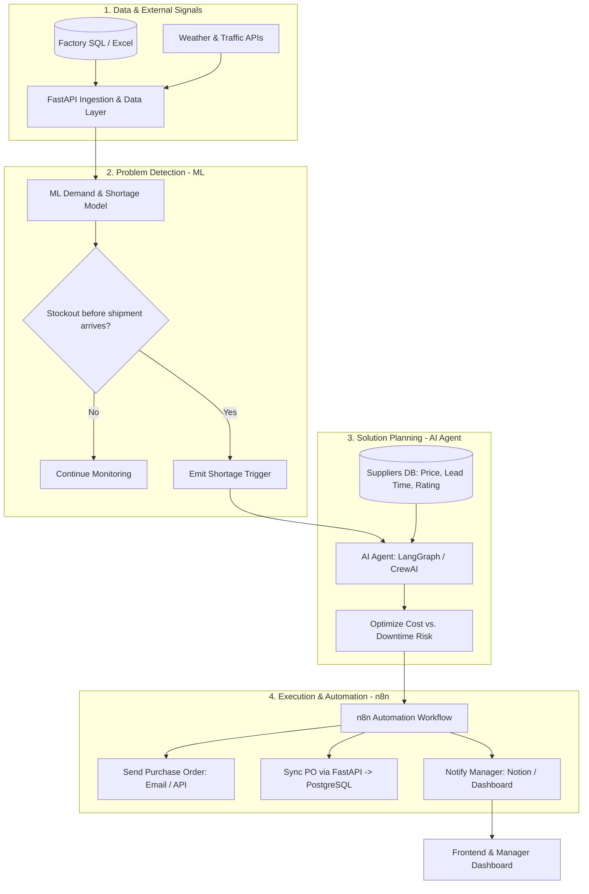

<div align="center">

# 🧠 Cognitive Supply Chain

### النظام الذكي الاستباقي لإدارة سلاسل الإمداد والمخزون

**An Autonomous AI-Powered System for Early Disruption Detection, Supplier Optimization, and Automated Procurement**

<p dir="rtl">
اكتشف الأزمة مبكرًا، اختر المورد الأنسب بالمنطق الاقتصادي، ونفّذ طلب الشراء آليًا قبل توقف المصنع.
</p>

*Detect Disruptions Early. Optimize Supplier Trade-Offs. Automate Execution Before Downtime Hits.*

[](#project-status)
[](#technology-stack)
[](#technology-stack)
[](#technology-stack)
[](#getting-started)

[📌 Overview](#overview) · [🏗️ Architecture](#system-architecture) · [🔄 Workflow](#workflow) · [🧰 Tech Stack](#technology-stack) · [🚀 Setup](#getting-started)

</div>

---

<a id="overview"></a>
## 📌 Overview | نظرة عامة

<div dir="rtl" align="right">

**Cognitive Supply Chain** هو نظام ذكي استباقي للمصانع والشركات يهدف إلى التنبؤ بأزمات نقص المواد الخام وتعطّل الإمداد قبل حدوثها، وتحويل التنبيهات إلى قرارات شراء مثالية وتنفيذ آلي كامل دون انتظار التدخل اليدوي المتأخر.

يجمع النظام بين بيانات المصنع الفعلية (أرصدة المخازن وحركة السحب اليومية) والعوامل الخارجية (الطقس وزحمة الطرق)، ليتنبأ بالخطر عبر نموذج تعلّم الآلة، ثم يفعّل وكيلًا ذكيًا (AI Agent) للمفاضلة بين الموردين، وينتهي بأتمتة إرسال طلب الشراء وإبلاغ مدير المصنع بتقرير مفصل.

</div>

The system operates around three core stages:

| Stage | Description |
|---|---|
| **1. Detect** | Pull factory stock/sales data (SQL / Excel) and external weather & traffic APIs, then forecast depletion dates with an ML model to emit early shortage triggers. |
| **2. Plan** | Wake an AI Agent (LangGraph / CrewAI) upon receiving a trigger to compare suppliers across price, delivery lead time, and reliability rating, minimizing total downtime cost. |
| **3. Execute** | Trigger n8n automation to dispatch Purchase Orders (Email / API), sync order state with the FastAPI database, and notify the factory manager on Notion or the project Dashboard. |

<a id="project-status"></a>
## 🚦 Project Status | حالة المشروع

> **Current stage: Repository structure, Docker setup, and legacy supply-chain preprocessing baselines are ready; core application modules are in MVP scaffolding.**

| Component | Current status | Notes |
|---|---|---|
| Data cleaning & feature notebooks | 🟢 Archived baseline | Prior DataCo & market signals notebooks/CSVs preserved under `legacy/supply_chain/`. |
| Docker & environment scaffolding | 🟢 Ready | Multi-stage Dockerfiles, `docker-compose.yml` (PostgreSQL, n8n, backend, frontend), and `.env.example` configured. |
| Backend API & ML forecasting | 🔧 MVP scope | Empty module placeholders under `backend/app/` (`api`, `core`, `schemas`, `services`, `ml`, `agent`, `automation`). |
| Frontend & manager dashboard | 🔧 MVP scope | Placeholders under `frontend/src/`, `frontend/dashboard/`, and `frontend/tests/`. |
| Automation workflows (n8n) | 🔧 MVP scope | Containerized n8n service configured for automated PO dispatch and manager alerts. |

<div dir="rtl" align="right">

**ملاحظة مهمة:** هيكل المستودع الحالي جاهز كـ **نقطة انطلاق (Project Skeleton)**؛ كما تم الاحتفاظ بملفات المعالجة السابقة (`DataCoSupplyChain` و`SC_Project`) داخل مجلد `legacy/supply_chain/` دون حذف أي عمل سابق للفريق.

</div>

### ⚠️ Technical Blueprint Note | ملاحظة حول الأدوات المقترحة

<div dir="rtl" align="right">

- الأدوات المذكورة في النظرة المعمارية (مثل `LangGraph` أو `CrewAI` أو `n8n` أو `React` / `Streamlit` أو `Notion`) تمثل **الإطار المعماري المرجعي** لشرح آلية عمل النظام.
- يمكن استبدال أي أداة أو إطار عمل بما يناسب احتياج الفريق أثناء التنفيذ مع الحفاظ على نفس تدفق البيانات والمسؤوليات بين المراحل الثلاث.

</div>

## ✨ Core Capabilities | الوظائف المستهدفة

The following capabilities describe the target end-to-end Cognitive Supply Chain design:

- **Multi-source data ingestion:** Connect to factory SQL databases or Excel/CSV exports for live stock levels and daily consumption history.
- **External disruption signals:** Fetch weather conditions and road/transport congestion via lightweight external APIs.
- **ML shortage forecasting:** Estimate daily burn rate, effective lead time under weather/traffic delays, and emit early warning triggers (e.g., stock ends in 3–4 days while delayed shipment arrives in 6 days).
- **Autonomous AI Agent planning:** Query approved factory suppliers and evaluate trade-offs between unit price, delivery lead time, and supplier rating.
- **Cost-vs-downtime optimization:** Prefer a slightly higher-cost rapid supplier (e.g., +3% cost arriving in 2 days) when avoiding factory downtime is far cheaper than waiting 5 days for a lower-cost supplier.
- **Automated PO execution (n8n):** Generate and send Purchase Orders automatically via Email or Supplier API, then sync order status back to the FastAPI backend and PostgreSQL database.
- **Executive notifications & dashboard:** Deliver concise decision summaries and approval links to the factory manager via Notion or the project Dashboard.

<a id="system-architecture"></a>
## 🏗️ System Architecture | المعمارية التقنية



<a id="workflow"></a>
## 🔄 End-to-End Workflow | مراحل عمل النظام

| Phase | Trigger / Input | System Action | Output |
|---|---|---|---|
| **Problem Detection** | Inventory balances, daily sales/consumption, weather & traffic APIs | ML model detects that current stock ends in 4 days while rain delays the incoming shipment to 6 days | Shortage alert trigger |
| **Solution Planning** | Shortage trigger + factory supplier list (price, lead time, rating) | AI Agent compares Supplier A (cheaper, 5 days -> 1-day factory halt) vs. Supplier B (+3% cost, 2 days -> zero halt) | Optimal supplier selection decision |
| **Execution & Automation** | Selected supplier & order quantity | n8n sends automated PO via Email/API, updates FastAPI DB, and alerts the factory manager | Dispatched PO + DB update + manager report |

## 🗂️ Repository Structure | هيكل المستودع

```text
Graduation-project/
├── README.md
├── requirements.txt
├── .env.example
├── .gitignore
├── .dockerignore
├── .gitattributes
├── Makefile
├── docker-compose.yml
├── docker-compose.dev.yml
│
├── backend/
│   ├── Dockerfile
│   ├── app/
│   │   ├── api/                # FastAPI routers & dependencies
│   │   ├── core/               # App config, DB setup, logging
│   │   ├── schemas/            # Pydantic models (inventory, suppliers, POs)
│   │   ├── services/           # Business orchestration
│   │   ├── ml/
│   │   │   ├── ingestion/      # SQL / Excel data loaders
│   │   │   ├── external_apis/  # Weather & traffic API clients
│   │   │   └── forecasting/    # Demand prediction & shortage triggers
│   │   ├── agent/              # LangGraph / CrewAI supplier optimization
│   │   └── automation/         # n8n PO dispatch & manager alerts
│   └── tests/
│
├── frontend/
│   ├── Dockerfile
│   ├── nginx.conf
│   ├── .env.example
│   ├── src/
│   ├── dashboard/
│   └── tests/
│
├── models/                     # Trained ML model artifacts (.gitkeep)
├── data/
│   ├── raw/                    # Raw factory & external datasets (.gitkeep)
│   └── processed/              # Cleaned features & splits (.gitkeep)
├── notebooks/                  # EDA & modeling experiments (.gitkeep)
├── scripts/
│   ├── ingest_data.py
│   ├── train_model.py
│   └── evaluate_model.py
├── docs/
│   ├── architecture.md
│   └── api.md
└── legacy/
    └── supply_chain/           # Preserved prior team notebooks & datasets
```

<a id="technology-stack"></a>
## 🧰 Technology Stack | الحزمة التقنية

| Layer | Technology | Intended Role |
|---|---|---|
| Frontend & Dashboard | React / Vite (or Streamlit), Nginx | Manager dashboard for stock alerts, supplier comparisons, and PO approvals. |
| Backend API | Python 3.11+, FastAPI, Pydantic | Data ingestion endpoints, trigger orchestration, and database updates. |
| ML & Problem Detection | scikit-learn, pandas, numpy (and forecasting models) | Daily burn-rate estimation, delay-adjusted stockout prediction, and trigger emission. |
| AI Agent & Planning | LangGraph / CrewAI + LLM APIs | Multi-criteria supplier comparison (price, lead time, rating) and optimization logic. |
| External Signals | Weather & Traffic REST APIs | Real-time transit and weather disruption context. |
| Database | PostgreSQL | Store inventory snapshots, supplier catalogs, triggers, and Purchase Orders. |
| Automation & Alerts | n8n, Email/SMTP, Notion API | Automated Purchase Order dispatch, FastAPI sync, and instant manager notifications. |
| Containerization | Docker & Docker Compose | Unified deployment of PostgreSQL, n8n, backend, and frontend services. |

## 📊 Decision Signals & Evaluation | مدخلات القرار ومؤشرات التقييم

| Area | Key Signals / Metrics |
|---|---|
| **Inventory & Demand** | Current stock balance, daily consumption rate, safety buffer, incoming shipment ETA |
| **External Risk** | Weather severity along transport routes, traffic/transit delay estimates |
| **Supplier Evaluation** | Unit cost (`%` delta vs. baseline), delivery lead time (days), historical supplier rating |
| **Model & System Metrics** | Forecast `MAE` / `RMSE`, stockout early-warning recall, downtime cost saved, trigger-to-PO latency |

<a id="getting-started"></a>
## 🚀 Getting Started | التشغيل المحلي

### Prerequisites | المتطلبات

- Python **3.11 or later**
- Node.js **20 or later** and npm (for React frontend development)
- Docker Engine / Docker Desktop with Docker Compose v2
- Git

### 1. Clone the repository

```bash
git clone <YOUR_REPOSITORY_URL>
cd Graduation-project
```

### 2. Configure environment variables

```bash
cp .env.example .env
```

On Windows PowerShell:

```powershell
Copy-Item .env.example .env
```

**Never commit `.env` or real API keys, passwords, database credentials, or tokens.**

### 3. Start the Docker stack

From the repository root:

```bash
make up
```

Or for hot-reload development mode:

```bash
make up-dev
```

View logs or stop containers:

```bash
make logs
make down
```

### 4. Local Python setup (Backend & ML Scripts)

```bash
python -m venv .venv
# Linux/macOS: source .venv/bin/activate
# Windows PowerShell: .venv\Scripts\Activate.ps1
pip install -r requirements.txt
```

Once modules are implemented under `backend/app/` and `scripts/`:

```bash
make test
make lint
make ingest
make train
make evaluate
```

## 🔐 Data & Credentials Policy | سياسة البيانات والاعتماد

- Raw and processed factory files placed in `data/raw/` and `data/processed/`, as well as trained binary model artifacts in `models/`, are excluded from Git via `.gitignore`.
- All service secrets (database passwords, Weather/Traffic APIs, LLM API keys, n8n encryption keys, SMTP, Notion tokens) must remain solely inside your local `.env`.

## 📄 License | الترخيص

This graduation project is developed for academic and research purposes. Third-party datasets (such as prior `DataCoSupplyChain` baselines archived in `legacy/supply_chain/`) remain subject to their original dataset terms.

---

<div align="center">

**«التنبؤ المبكر يحمي خط الإنتاج، والقرار الذكي يحوّل الأزمة إلى استقرار تشغيلي.»**

*Cognitive Supply Chain — Predict Early. Plan Smart. Automate Fast.*

</div>
